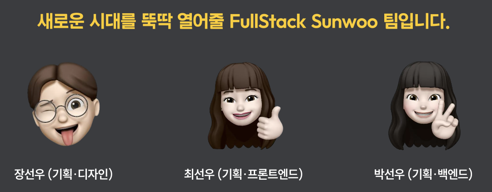

<div align="center">

# 깨비뚝딱 Backend ✨

### 자연어 금융 요청을 검증 가능한 위젯 JSON으로 변환하는 Generative UI API

[](https://spring.io/projects/spring-boot)
[](https://openjdk.org/)
[](https://www.hankyung.com/article/202609032008P)
[](https://kkbb-ddookddak.netlify.app)

</div>

## 🏆 제8회 Future Finance AI Challenge 대상

> **풀스택 선우**팀의 **깨비뚝딱**이 대상인 **금융감독원상**을 수상했습니다.

- 본선: 2026년 9월 2일, 이화여자대학교 이삼봉홀
- 경쟁: 전국 약 300개 참가팀 중 본선 10팀 진출
- 팀: 장선우(기획·디자인), 최선우(기획·프론트엔드), 박선우(기획·백엔드)
- 수상 기사: [한국경제](https://www.hankyung.com/article/202609032008P) · [더퍼스트미디어](https://www.thefirstmedia.net/news/articleView.html?idxno=207727) · [스마트투데이](https://www.smarttoday.co.kr/ko-kr/articles/111151)

<p align="center">
  
</p>

## 개요

사용자의 상황에서 검토할 업무를 먼저 판단하고, KB스타뱅킹 JSON 메뉴로 연결합니다.

```text
POST /api/canvas
→ JEV 상황·업무 판단(최대3개)
→ 업무별 로컬 E5 의미검색
→ JEV 메뉴 선택·직접요청/추가제안 구분(일괄1회)
→ 기존 메뉴 ID 검증·응답
```

기본 경로에는 글자검색과 글자검색 폴백이 없습니다. 로컬 검색이 꺼져 있으면 503을 반환합니다. 의미검색 준비·실행은 [로컬 검색 안내](scripts/semantic/README.md)를 참고하세요.

## API

요청: POST /api/canvas, `{"message":"처음 일본 여행을 가는데 뭘 준비할까?"}`

`menus`에는 선택한 기존 메뉴 객체들이, `recommendations`에는 각 메뉴의 `needId`, `need`, `basis`, `explanation`이 포함됩니다. `basis=explicit`은 직접 요청한 업무, `suggested`는 상황상 검토할 추가 제안, `uncertain`은 이 구분만 불확실한 경우입니다. 이 부가 구분은 확실한 메뉴 선택을 막지 않습니다. `menuConfidence`와 `basisConfidence`를 별도로 반환하며, 보류·추가 제안 제외 이유는 `decision_notes`에서 확인합니다. 금융 거래나 가입은 실행하지 않습니다.

`status`: ready, partial, needs_clarification, no_match, empty. 복수 업무를 요청했다는 이유만으로 하나로 좁히도록 요구하지 않습니다. 일부 연결만 불확실하면 partial을 반환합니다. `widgets`는 빈 배열을 유지합니다.

`selection_metrics`: retrievalMode=semantic_only, planningMs, retrievalMs, selectionMs, jevCalls(0~2).

## 검증 결과

동일 합성 질문50개: 기존 단일 메뉴38/50·평균307ms, 상황 방식44/50·464ms. 상황20개는9→17개 정답, 직접요청30개는29→27개로 일부 회귀했습니다. [원본 결과](docs/situation-selection-results.json)

업무 분류는54개의 정의와 기타 명확한 메뉴 요청 경로를 사용합니다. 무제한 자유 추론이 아니며 합성 평가가 실사용 정확도를 보장하지 않습니다. [상세 설계](docs/JEV_CANVAS.md)

## 실행 방법

### 요구사항

- Java 17+
- JEV API Key (`JEV_AI_API_KEY`)

### macOS / Linux

```bash
export JEV_AI_API_KEY="your-jev-api-key"
./mvnw spring-boot:run
```

### Windows PowerShell

```powershell
$env:JEV_AI_API_KEY="your-jev-api-key"
./mvnw.cmd spring-boot:run
```

서버는 기본적으로 `http://localhost:8080`에서 실행됩니다.

## 환경 변수

| 이름 | 필수 | 설명 |
| --- | --- | --- |
| `JEV_AI_API_KEY` | Yes | JSON 메뉴 선택용 jev 인증 키 |
| `JEV_MODEL` | No | 기본 `jev-latest` |
| `JEV_MIN_CONFIDENCE` | No | 기본 0.6, 확률 보정이 검증된 값은 아님 |
| `OPENAI_API_KEY` | No | 기존 GPT 비교 실험에만 필요 |


## 테스트

```bash
./mvnw test
```

API 직접 호출:

```bash
curl -X POST http://localhost:8080/api/canvas \
  -H "Content-Type: application/json" \
  -d '{"message":"지갑을 잃어버렸어. 긴급 조치 화면을 만들어줘"}'
```

## 프로젝트 구조

```text
src/main/java/com/example/kb_ai_backend
├── config
│   └── CorsConfig.java
├── controller
│   └── CanvasController.java
└── service
    ├── OpenAiApiService.java
    ├── WidgetDataService.java
    └── ExchangeRateService.java
```

## 향후 확장

- KB 계좌·카드 API 어댑터
- OAuth 및 본인인증
- 정부24·경찰청 공공 API
- 결제·ATM·보험 API
- 감사 로그, 개인정보 암호화, 운영 모니터링

> 핵심 생성 기술은 이미 구현되어 있으며, 이후 확장은 인증·보안·외부 금융 API를 단계적으로 연결하는 엔지니어링 과제입니다.
